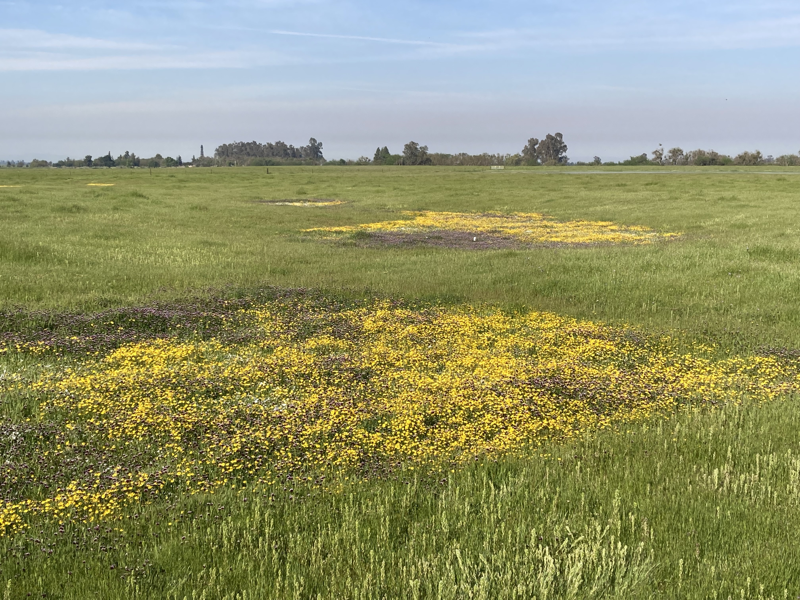

## Dissertation Research Projects

::: researchcontainer
### Ch. 1: Hydrologically informed estimation of plant species richness in vernal pools using UAV-LiDAR

::: {.columns .v-center}
::: {.column width="40%"}
{width="100%"}
:::

::: {.column width="60%"}
Hydrology strongly structures plant communities in wetlands, but its effects are difficult to quantify in ephemeral systems such as vernal pools, where water movement and retention vary rapidly at fine spatial scales. These dynamics are typically unresolved by satellite remote sensing, limiting long-term ecological monitoring.

To address this challenge, I used drone-mounted LiDAR to generate high-resolution (1 m) digital elevation models over vernal pool complexes and derived hydrologic proxies related to hydroperiod, connectivity, and soil moisture. These variables were used to model total plant species richness, as well as forb and grass richness. The resulting models predicted richness within 2--3 species, highlighting the potential of drone-based LiDAR to fill monitoring gaps where intensive field surveys are impractical.
:::
:::
:::

::: researchcontainer
### Ch. 2: Biodiversity monitoring on floodplain ecosystems using remote sensing and multi-locus metabarcoding

::: {.columns .v-center}
::: {.column width="60%"}
Groundwater regulation in California's San Joaquin Valley is expected to result in the fallowing of up to 500,000 acres of agricultural land, creating substantial land-use change with uncertain ecological consequences. While hydrologic and economic impacts have been widely studied, biodiversity responses remain poorly understood, particularly where fallowed lands intersect remnant or restored riparian habitats.

Working with collaborators at UC Santa Cruz and UC Merced, I combine remote sensing with multi-locus eDNA metabarcoding to assess biodiversity across these mixed agricultural--riparian mosaics. Remote sensing captures ecosystem structure and vegetation dynamics, while eDNA provides community-level information on taxa that are otherwise invisible to optical sensors. Together, these approaches offer an integrated view of ecosystem structure, function, and biological diversity.
:::

::: {.column width="40%"}
 [WHONDRS consortium](https://www.pnnl.gov/projects/WHONDRS). This picture is of a sample collection at the Grayson Riverbend Preserve on the San Joaquin River, CA.](imgs/JN_sampling.jpg){width="100%"}
:::
:::
:::

::: researchcontainer
### Ch. 3: OpenRES: A QGIS plugin for automated extraction of hydrogeomorphic features to support functional process zone classification of river networks

::: {.columns .v-center}
::: {.column width="40%"}
{width="100%"}
:::

::: {.column width="60%"}
Functional process zones (FPZs) --- hydrogeomorphic units defined at valley-to-reach scales---provide a powerful framework for understanding riverine biodiversity patterns across watersheds. FPZs integrate hydroclimate, geology, and channel--valley morphology, capturing spatial heterogeneity that is often poorly explained by continuum-based river models.

Despite their utility, FPZs remain underused due to reliance on outdated or unsupported spatial tools and the lack of open-source alternatives. To address this gap, I have developed [OpenRES](https://github.com/jollygoodjacob/OpenRES), an open-source QGIS plugin that automates extraction of hydrogeomorphic metrics from remote sensing data and supports classification of river segments into FPZs. This tool underpins key components of my dissertation research and supports collaborative work with the BioSCape campaign.
:::
:::
:::

## Collaborations and Other Projects

::: researchcontainer
### NASA BioSCape Campaign: Biodiversity Across Scales

::: {.columns .v-center}
::: {.column width="60%"}
I am working with collaborators from the University of Colorado Boulder and the University of California, Santa Cruz on a project within NASA's first biodiversity-focused airborne observation campaign (BioSCape). This work examines phylogenetic, taxonomic, and functional biodiversity across connected freshwater--marine watersheds along the Berg and Eerste Rivers in South Africa's Greater Cape Floristic Region.

Our goal is to improve biodiversity mapping by clarifying how functional diversity relates to phylogenetic and taxonomic diversity across space and time. We integrate environmental DNA (eDNA), traditional field surveys, and airborne remote sensing, drawing on insights from Mediterranean-climate watersheds in California to evaluate how these observation methods complement one another across spatial and temporal scales.
:::

::: {.column width="40%"}
{width="100%"}
:::
:::
:::

::: researchcontainer
### Internet of Things for Precison Agriculture (US NSF IoT4Ag): Sensor fusion for precision agriculture applications

::: {.columns .v-center}
::: {.column width="40%"}
{width="100%"}
:::

::: {.column width="60%"}
Precision agriculture requires timely, spatially detailed estimates of key variables such as vegetation cover, water stress, and productivity. No single remote sensing platform can simultaneously provide the spatial, temporal, spectral, and radiometric resolution needed for these applications, creating inherent tradeoffs.

To overcome these limitations, I have been developing sensor fusion approaches that combine information from satellites, drones, and aircraft. In particular, I used classified drone imagery as training data for machine-learning models to estimate fractional vegetation cover from Planet CubeSat imagery. This work was published as a conference proceeding at IGARSS 2023, and is now being extended by members of the Earth Observation and Remote Sensing Lab in collaboration with the IoT4Ag Engineering Research Center.
:::
:::
:::
