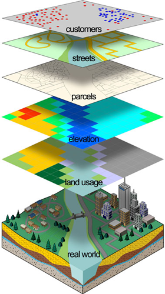
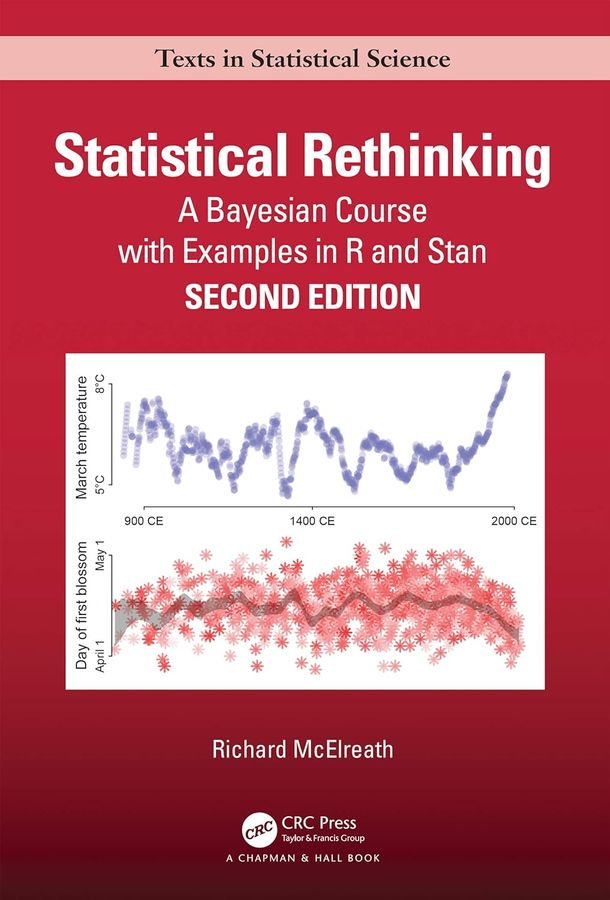
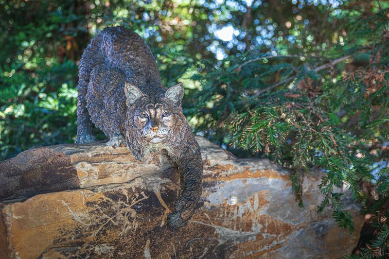
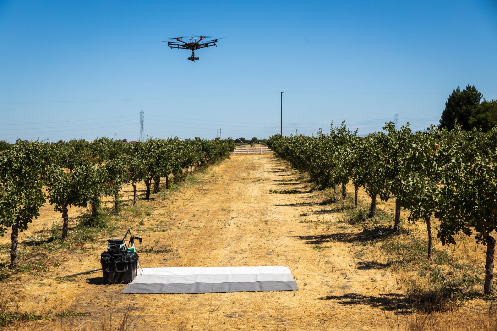
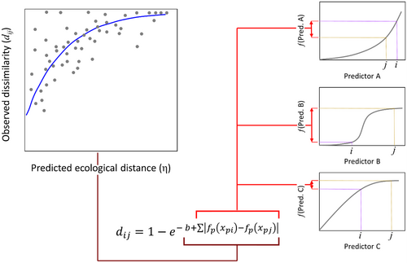

::: {.researchcontainer .lead-card}
I approach teaching geospatial science as both a conceptual and practical discipline that links spatial theory to real world environmental problem solving. My goal is to help students move beyond software proficiency to understand how spatial data are generated, structured, and interpreted, and how those choices shape scientific inference.
:::

## Teaching Assistantships / Course Co-Design

::: researchcontainer
[Teaching Assistant · Spring 2025]{.eyebrow}

### ENGR 180: Spatial Analysis and Modeling

University of California, Merced (Instructor of Record: Dr. Crystal Kolden)

::: {.columns .v-center}
::: {.column width="40%"}
{width="100%"}
:::

::: {.column width="60%"}

This 4-unit course explored the foundations and applications of modern geospatial science in a world where location-based data shapes how we understand and manage Earth systems. 

Students developed a conceptual grounding in cartography, map projections, coordinate systems, geodesy, and remote sensing, while building practical skills in spatial analysis and problem-solving. 

Through hands-on experience with GIS, GPS/GNSS, aerial and satellite imagery, drones, and digital geodatabases, students learned how geospatial data are generated, interpreted, and applied across diverse industries to model and analyze real-world phenomena.
:::
:::
:::

::: researchcontainer
[Course Co-designer · Spring 2024]{.eyebrow}

### ES 292: Introduction to Bayesian Statistics

University of California, Merced (Instructor of Record: Dr. Erin Hestir)

::: {.columns .v-center}
::: {.column width="60%"}

This 2-unit course served as an accessible and practical introduction for graduate students to the applications of Bayesian statistics for statistical inference in environmental data analysis. Research in environmental systems increasingly involves complex datasets and uncertainties and Bayesian statistics can provide a robust framework for handling the intricacies of environmental data, incorporating prior knowledge and making informed inferences without the confusing use of p-values.
:::

::: {.column width="40%"}
{width="80%"}
:::
:::
:::

## Guest Lectures

::: researchcontainer
[Guest Lecturer]{.eyebrow}

### Bobcat Summer STEM Academy

University of California, Merced

::: {.columns .v-center}
::: {.column width="40%"}
{width="100%"}
:::

::: {.column width="60%"}
Bobcat Summer STEM Academy (BSA) offers an exciting lineup of two-day, three-day, and weeklong workshops designed for 1st--12th grade students at the University of California, Merced. Created by UC Merced faculty, postdocs, research scientists, students, and staff, each workshop provides a unique, hands-on STEM experience that brings science, technology, engineering, and math to life.
:::
:::
:::

::: researchcontainer
[Guest Lecturer]{.eyebrow}

### ME 190: Novel Technologies in Agriculture

University of California, Merced (Instructor of Record: Dr. Reza Ehsani)

::: {.columns .v-center}
::: {.column width="60%"}
Introduces the principle of operation and application of novel sensor systems for measuring soil and plant parameters along with advanced smart machinery systems for crop scouting, appropriate data communication protocols, and data analysis methods in crop production systems.
:::

::: {.column width="40%"}
{width="100%"}
:::
:::
:::

## Workshops

::: researchcontainer
[Workshop]{.eyebrow}

### Generalized Dissimilarity Modeling

::: {.columns .v-center}
::: {.column width="40%"}
{width="100%"}
:::

::: {.column width="60%"}
Modeling the compositional turnover of species, known as beta diversity, is often a challenging statistical process, due to the complexities of nonlinearity, as well as the violation of standard independence assumptions common to the statistical approaches we are used to. To overcome some of these challenges, we explored generalized dissimilarity modeling (Ferrier et al. 2007), which has been developed to specifically account for these issues in predicting beta diversity.

GitHub link to GDM modeling workshop materials [here](https://github.com/jollygoodjacob/GDM_workshop).
:::
:::
:::
